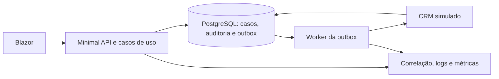

# Desafio: Plataforma de Atendimento de Contas

## Execução local

Pré-requisito: Docker com Compose. Na raiz do repositório, execute:

```bash
docker compose up --build
```

Abra <http://localhost:8080>. A página inicial oferece dois atendentes e uma supervisora fictícios; escolha um atendente, acesse **Clientes**, busque Marina por nome e abra seu contexto. O botão **Abrir contestação de tarifa** registra o novo caso e mostra protocolo, responsável, prioridade e prazo. **Repetir última tentativa** devolve o mesmo protocolo. Pelo link **Conduzir a solicitação**, atribua o caso a outro atendente, registre uma interação, inicie a análise, altere a prioridade ou o prazo e resolva com justificativa. A linha do tempo mostra autor, instante, motivo e valores anteriores e novos. Troque para **Clara Souza — Supervisor** e abra **Supervisão** para filtrar casos por status, prioridade, responsável e prazo; a fila inclui cenários fictícios próximos do prazo, vencidos em “Aguardando cliente” e resolvidos. Abra o caso resolvido e informe o motivo para reabrir em análise. Marina e Rafael também têm solicitações anteriores e contatos distintos para demonstrar o histórico. O host aplica as migrações do EF Core e insere esses registros com identificadores fixos; reiniciar o Compose não os duplica. Para conferir os serviços, acesse <http://localhost:8080/health> e execute `docker compose ps`. O PostgreSQL fica acessível somente na máquina local em `127.0.0.1:5433`; o simulador de CRM responde em <http://localhost:8081/health>.

### Demonstrar falha e recuperação do CRM — T-09

Selecione **Clara Souza — Supervisor**, abra **Supervisão** e clique em **Indisponibilizar CRM**. Troque para **Ana Costa — Atendente**, abra uma nova contestação e siga para **Conduzir a solicitação**: o caso permanece salvo e a seção **Sincronização com CRM** mostra o envio pendente, suas tentativas e, após três falhas, o estado **Falha**. Use **Atualizar sincronização** para acompanhar. Volte à supervisão como Clara, clique em **Restaurar CRM**, abra o caso na fila e clique em **Tentar envio novamente**; a seção passa a **Sincronizada** quando o worker o entrega. O simulador guarda os eventos e a projeção do caso no PostgreSQL; reiniciar o container não duplica um evento já aceito. O controle de disponibilidade e as identidades são somente para demonstração local.

### Roteiro de demonstração — 3 a 5 minutos

1. **Entrada e contexto (40 s):** em <http://localhost:8080>, escolha **Ana Costa**, abra **Clientes**, busque `Marina` e mostre os casos e contatos anteriores, todos fictícios.
2. **Abertura e duplicidade (45 s):** abra uma contestação, anote o protocolo e clique em **Repetir última tentativa**. O mesmo protocolo confirma a chave idempotente. Siga para **Conduzir a solicitação**.
3. **Condução e histórico (60 s):** atribua o caso a Bruno com motivo, registre uma interação, inicie a análise e resolva com justificativa. Mostre autor, instante, motivo, valores anteriores e novos na linha do tempo. Para demonstrar conflito, abra o mesmo caso em duas abas antes de uma alteração: altere em uma e tente salvar com a versão antiga na outra; a segunda recebe a mensagem de conflito e **Ler estado atual**.
4. **Supervisão e diagnóstico (40 s):** troque para **Clara Souza**. Em **Supervisão**, filtre os casos próximos do prazo e vencidos. Veja **Diagnóstico operacional** para volume de casos, envios pendentes/com falha, tentativas com falha e duração média de abertura, alteração e envio. Abra o caso resolvido do seed para demonstrar reabertura exclusiva com motivo.
5. **Falha e recuperação (60 s):** em **Supervisão**, indisponibilize o CRM. Troque para Ana, abra outro caso, mostre que ele persiste enquanto a sincronização passa de pendente para falha. Volte como Clara, restaure o CRM, abra o caso na fila e use **Tentar envio novamente**. Atualize até ver **Sincronizada**. O ID de correlação e o ID do evento aparecem ao lado da tentativa.

Para uma verificação curta dos serviços e logs, use `docker compose ps` e `docker compose logs app --since=5m`. Procure o `CorrelationId` exibido no caso; os logs registram IDs técnicos, operação, resultado e duração. A API aceita um UUID opcional em `X-Correlation-ID` e o devolve no mesmo cabeçalho. O endpoint `GET /api/demo/diagnostics` exige a sessão de supervisor. A página de supervisão mostra contagens atuais do PostgreSQL e durações acumuladas no processo; métricas OpenTelemetry também são exportadas periodicamente no console do app.

### Arquitetura e decisões



| Decisão | Alternativa considerada | Custo assumido |
| --- | --- | --- |
| Monólito modular com Blazor no mesmo host da API | Implantar front e API separadamente | Menos serviços para executar, mas exige disciplina de dependências entre domínio, aplicação, infraestrutura e interface. |
| Outbox transacional com entrega pelo menos uma vez | Chamar o CRM durante a requisição de abertura/alteração | Mantém o caso íntegro em falhas externas, mas requer worker, retentativas e deduplicação no destino. |
| Versão explícita e atualização condicional no PostgreSQL | Aceitar a última gravação sem aviso | Evita perda silenciosa de mudanças, mas a interface precisa apresentar e atualizar a versão após conflitos. |
| PostgreSQL também nos testes de integração | Banco em memória ou SQLite | Testa transação, índice e concorrência reais, mas requer Docker local. |

Os dados, papéis, prazos e falhas são fictícios. A seleção de usuário não autentica uma pessoa real; o controle de falha do CRM, a porta local do simulador e a senha do Compose existem para a demo. Para operar com dados reais seriam necessários autenticação forte, autorização mais fina, proteção e retenção de dados, gestão de segredos, monitoramento persistente com coletor externo e políticas de prazo da instituição. As durações exibidas na tela são médias do processo atual e reiniciam com o app; as contagens de casos e mensagens vêm do banco.

### Rodar a API pelo terminal

Na raiz do repositório, inicie apenas o banco e depois o host ASP.NET Core:

```bash
docker compose up -d postgres crm-simulator
dotnet run --project backend/Api --launch-profile http
```

Abra <http://localhost:5080>. O perfil `http` usa `appsettings.Development.json`, que aponta para o PostgreSQL local na porta `5433` e para o simulador na porta `8081`; o host aplica as migrações e os dados fictícios automaticamente. Se você executar `dotnet run` de dentro de `backend/Api`, use `dotnet run --launch-profile http` depois de subir os dois serviços.

`backend/Api` é o host ASP.NET Core: registra dependências e expõe os endpoints Minimal API. Os componentes Razor e os arquivos estáticos da interface ficam em `frontend`. A API hospeda essa biblioteca Blazor no mesmo processo, conforme o plano do monólito modular.

Para compilar e testar a solução localmente, use `dotnet build Desafio.Plataforma-de-Atendimento-de-Contas.sln` e `dotnet test Desafio.Plataforma-de-Atendimento-de-Contas.sln`. Os testes de integração da T-06 a T-10 criam bancos PostgreSQL descartáveis e são marcados como ignorados sem `TEST_POSTGRES_CONNECTION`. Com o banco do Compose iniciado, execute a suíte completa assim:

```bash
TEST_POSTGRES_CONNECTION='Host=127.0.0.1;Port=5433;Database=postgres;Username=atendimento;Password=local_demo_only' dotnet test --no-restore
```

A T-02 adiciona as tabelas de solicitações, interações, auditoria, idempotência e outbox, com chaves estrangeiras e índices. A T-03 implementa as regras de abertura, transição, histórico, bloqueio de caso resolvido e prazo em dias úteis no domínio, com testes xUnit. A T-04 adiciona uma sessão por cookie ao selecionar um usuário fictício, protege o catálogo e expõe uma visão resumida da carteira apenas ao supervisor. A T-05 adiciona busca de clientes, solicitações e contatos associados a elas em ordem cronológica, na API e na interface. A T-06 abre contestações com chave idempotente persistida e cria caso, auditoria e mensagem pendente de outbox em uma transação. A T-07 conduz casos com alteração condicional por versão no PostgreSQL, auditoria e interação na mesma transação; um conflito retorna 409 e a tela permite ler o estado atual antes de refazer a decisão. A T-08 adiciona a fila paginada de supervisão, indicadores de prazo e reabertura exclusiva por supervisor, também sujeita a motivo e versão. A T-09 entrega os eventos de abertura, status e atribuição ao CRM por um worker com retentativas; o destino deduplica por ID de evento e ignora versões antigas na projeção. A T-10 acrescenta correlação, logs estruturados, métricas OpenTelemetry e diagnóstico na supervisão. A seleção e o encerramento de sessão exigem token antifalsificação; clientes HTTP podem obtê-lo em `GET /api/auth/csrf` e enviá-lo no cabeçalho `X-CSRF-TOKEN`, renovando o token após uma troca de sessão. O mecanismo de seleção não autentica pessoas reais e só serve à demonstração.

| Rota | Acesso | Resposta |
| --- | --- | --- |
| `GET /api/auth/users` | Público | Lista de usuários fictícios ativos. |
| `GET /api/auth/csrf` | Público | Token para chamadas mutáveis; também define cookie antifalsificação. |
| `POST /api/auth/session` | Público, com CSRF | Recebe `{ "userId": "..." }` e devolve usuário selecionado; 400 para entrada inválida e 404 para usuário ausente ou inativo. |
| `GET /api/auth/session` | Sessão | Usuário atual; 401 sem sessão. |
| `DELETE /api/auth/session` | Sessão e CSRF | Encerra a sessão; 401 sem sessão. |
| `GET /api/demo/catalog` | Atendente ou supervisor | Catálogo fictício; 401 sem sessão. |
| `GET /api/demo/supervisor/overview` | Supervisor | Quantidade de solicitações; 401 sem sessão e 403 para atendente. |
| `GET /api/clients?query=` | Atendente ou supervisor | Até 20 clientes por nome ou identificador; 400 para busca vazia ou com mais de 100 caracteres. |
| `GET /api/clients/{id}` | Atendente ou supervisor | Cliente, suas solicitações e contatos ligados a elas em ordem cronológica; 400 para ID inválido e 404 para cliente ausente. |
| `POST /api/requests` | Atendente, com CSRF | Recebe `{ "clientId": "...", "description": "..." }` e o cabeçalho `Idempotency-Key`; 201 na abertura, 200 na repetição idêntica, 409 com `idempotency_conflict` se o conteúdo mudar. |
| `GET /api/requests/{id}` | Atendente ou supervisor | Estado, versão, interações, auditoria e último estado de sincronização. |
| `POST /api/requests/{id}/interactions` | Atendente, com CSRF | Recebe `version` e `text`; registra interação e devolve o estado atualizado. |
| `POST /api/requests/{id}/status` | Atendente, com CSRF | Recebe `version`, `status` e `reason`; inclui a resolução com justificativa. |
| `POST /api/requests/{id}/assignment` | Atendente, com CSRF | Recebe `version`, `assigneeId` e `reason`. |
| `POST /api/requests/{id}/priority` | Atendente, com CSRF | Recebe `version`, `priority` e `reason`. |
| `POST /api/requests/{id}/deadline` | Atendente, com CSRF | Recebe `version`, `deadlineAtUtc` e `reason`; o prazo deve estar em UTC. |
| `GET /api/requests?status=&priority=&assigneeId=&due=&page=&pageSize=` | Supervisor | Fila paginada e ordenada por prazo; `due` aceita `DueSoon` (próximas 24 horas) ou `Overdue`; `pageSize` é de 1 a 50. Casos resolvidos não entram nos filtros de prazo. |
| `POST /api/requests/{id}/reopen` | Supervisor, com CSRF | Recebe `version` e `reason`; reabre caso resolvido em análise, registra auditoria e outbox na mesma transação. |
| `GET /api/requests/{id}/sync` | Atendente ou supervisor | Estado agregado e tentativas dos eventos de sincronização do caso. |
| `POST /api/requests/{id}/sync/retry` | Supervisor, com CSRF | Recoloca os eventos com falha na fila para envio. |
| `GET /api/demo/crm` | Supervisor | Disponibilidade atual do simulador. |
| `POST /api/demo/crm/unavailable` e `/available` | Supervisor, com CSRF | Provoca e encerra a indisponibilidade simulada. |
| `GET /api/demo/diagnostics` | Supervisor | Contagens operacionais e duração das operações, sem dados de cliente. |

Erros da API retornam `ProblemDetails` com título em português e um campo `code` técnico. Erros inesperados retornam `internal_error` e `correlationId`, sem mensagem interna. A interface usa formulários protegidos para iniciar ou trocar a sessão.
As alterações de caso com versão antiga retornam `version_conflict` (409) com apenas identificador e versão atual; nenhuma alteração ou evento é gravado. O worker envia eventos em ordem de versão do caso, usa até três tentativas automáticas e mantém uma falha terminal visível para a recuperação manual. O payload de integração contém somente identificadores e estado técnico do caso, sem nome do cliente, descrição ou texto das interações.

## Contexto

Uma instituição financeira atende clientes por diferentes canais. Durante um contato, o atendente precisa entender rapidamente o contexto da conta, consultar solicitações anteriores e registrar o que foi combinado. Quando a informação fica espalhada entre sistemas, o atendimento perde continuidade, os prazos ficam difíceis de acompanhar e integrações com ferramentas de relacionamento podem falhar sem que a equipe perceba.

## Problema

Como oferecer aos atendentes uma visão confiável do histórico do cliente e um fluxo claro para tratar solicitações, sem perder informações quando dois profissionais atuam no mesmo caso ou quando um sistema externo está indisponível?

## Objetivo

Construa uma **plataforma fictícia de atendimento de contas**. Ela deve permitir consultar o contexto de um cliente, abrir e acompanhar solicitações, registrar interações, controlar prazos e sincronizar informações com um CRM simulado.

Use **C# e .NET em toda a aplicação, inclusive na interface**. Trabalhe somente com dados fictícios. O projeto é uma simulação de engenharia: não deve usar marcas, identidades visuais, dados reais ou alegar que reproduz sistemas internos de qualquer instituição.

## Cenário principal

Uma cliente questiona uma tarifa lançada em sua conta. O atendente localiza seu cadastro fictício, visualiza as interações registradas em solicitações anteriores, abre uma contestação e recebe um protocolo. Outro atendente assume a solicitação, registra uma interação e atualiza o andamento. Quando a análise termina, a solicitação é resolvida com uma justificativa. Um supervisor consegue identificar casos próximos do prazo e verificar o histórico das decisões.

Esse cenário deve funcionar integralmente pela interface. A integração com o CRM deve ocorrer sem impedir o registro do atendimento quando o serviço externo falhar.

## Perfis e funcionalidades

### Atendente

- Consultar clientes fictícios identificados apenas por ID e nome fictícios.
- Ver solicitações abertas e o histórico de interações registradas nas solicitações de um cliente.
- Abrir uma contestação de tarifa e receber um protocolo único.
- Assumir ou atribuir qualquer solicitação, registrar interações e alterar seu status.
- Resolver uma solicitação com justificativa e consultar seu histórico de alterações.

### Supervisor

- Consultar solicitações por status, prioridade, responsável e prazo.
- Identificar solicitações próximas do vencimento ou vencidas.
- Consultar o histórico de uma solicitação e reabri-la com motivo registrado.

## Regras obrigatórias

1. Cada solicitação possui protocolo único, cliente, tipo, status, prioridade, responsável e prazo de atendimento. Na abertura, o sistema define prioridade Média, atribui o caso ao atendente que o abriu e calcula o prazo em dias úteis conforme a prioridade.
2. Os status são **Aberta**, **Em análise**, **Aguardando cliente** e **Resolvida**. Documente as transições permitidas. A reabertura de uma solicitação resolvida exige motivo e registro no histórico.
3. Toda mudança de status, prioridade, responsável ou prazo registra quem fez a alteração, quando ela ocorreu e o motivo informado.
4. Uma alteração baseada em dados desatualizados não pode sobrescrever silenciosamente uma alteração mais recente feita por outro atendente. A interface deve informar o conflito.
5. A interface gera uma chave para cada tentativa de abertura e a preserva se precisar repetir a tentativa. Repetir a mesma requisição não pode gerar dois protocolos; reutilizar a mesma chave com dados diferentes deve ser tratado como conflito.
6. Uma falha na sincronização com o CRM não pode apagar nem desfazer uma solicitação já registrada. O sistema deve mostrar que a sincronização está pendente ou falhou e permitir sua recuperação.
7. O cadastro usa apenas ID e nome fictícios, sem documento ou número de conta. Nome, descrições e interações não devem aparecer em logs, métricas ou mensagens de erro.
8. Qualquer atendente pode consultar e alterar qualquer solicitação. A reabertura de um caso resolvido é exclusiva do supervisor. O projeto pode usar usuários de demonstração; não deve depender de credenciais reais.

## Stack e limites

| Área | Tecnologia ou restrição |
| --- | --- |
| Interface | Blazor |
| Backend | ASP.NET Core e C# |
| Persistência local | Entity Framework Core com DB de sua preferência |
| Testes | xUnit e testes de integração dos fluxos críticos |
| Observabilidade | Logs estruturados, identificador de correlação e métricas básicas com OpenTelemetry |
| Integração | Adaptador para um CRM simulado, sem dependência de uma conta em serviço comercial |
| Execução | Um comando documentado para iniciar a demonstração com dados fictícios |

Organize a aplicação como um **monólito modular**, com limites claros entre atendimento, consulta de clientes e integração. Microsserviços, infraestrutura de nuvem e operações financeiras reais não fazem parte do desafio.

## Entregas

### Essencial

- Interface funcional para percorrer o cenário principal.
- API, persistência, migrações e dados fictícios de demonstração.
- Regras de status, auditoria, prevenção de duplicidade e tratamento de concorrência.
- CRM simulado com possibilidade de provocar uma falha e observar a recuperação.
- Testes automatizados para as regras e os fluxos de maior risco.

### Documentação

- `README.md` com objetivo, requisitos para execução, comando de inicialização e roteiro de demonstração.
- Diagrama simples dos módulos e do fluxo de sincronização com o CRM.
- Registro de pelo menos **três decisões técnicas**, explicando a escolha, a alternativa considerada e o custo da decisão.
- Explicação dos limites da simulação e das melhorias que seriam necessárias para operar com dados reais.

## Critérios de aceite

Considere o desafio concluído quando outra pessoa conseguir, seguindo apenas o README:

1. Iniciar a aplicação e entrar com um usuário fictício.
2. Encontrar uma cliente, abrir uma contestação e consultar o protocolo e o histórico.
3. Alterar responsável e status, registrar uma interação e resolver o caso com justificativa.
4. Identificar no painel do supervisor uma solicitação próxima do prazo.
5. Repetir uma abertura sem criar protocolo duplicado.
6. Simular uma edição concorrente e receber uma mensagem clara de conflito.
7. Indisponibilizar o CRM simulado, confirmar que o atendimento continua salvo e observar a sincronização após a recuperação.
8. Executar os testes automatizados e verificar que os dados exibidos e registrados são fictícios.

## Como apresentar o projeto

Prepare uma demonstração de **3 a 5 minutos** centrada na jornada de atendimento. Mostre o caso na interface, o histórico de decisões, uma falha controlada do CRM e a recuperação da integração. Depois explique as decisões que preservam os dados e permitem investigar problemas. Deixe o código e o diagrama disponíveis para quem quiser aprofundar a avaliação técnica.
