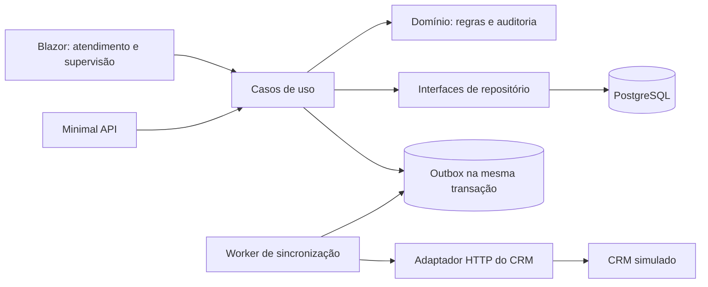

# Plano técnico — Plataforma de Atendimento de Contas

**Base:** [`constituition.md`](constituition.md) e [`spec.md`](spec.md)  
**Estado:** plano de implementação; as etapas abaixo ainda não foram executadas.  
**Escopo:** primeira versão demonstrável, somente com pessoas e dados fictícios.

## 1. Objetivo e decisões de arquitetura

Construir um monólito modular em .NET 10. O mesmo processo hospeda a Minimal API e a interface Blazor Web App com interatividade no servidor. PostgreSQL guarda casos, histórico, chaves de idempotência, mensagens de integração e o estado do CRM simulado. Um worker em segundo plano envia as mensagens pendentes por um adaptador HTTP para um **simulador de CRM separado apenas como dependência de demonstração**. A falha e a recuperação do simulador poderão ser acionadas pela interface. Não há operações financeiras.

As regras de status, prazo e alteração de uma solicitação ficam nos modelos de domínio. Casos de uso coordenam autorização, repositórios e transações. Endpoints validam a entrada superficial, identificam o usuário e chamam casos de uso; nunca acessam o `DbContext`. Blazor também chama casos de uso, sem acesso direto ao banco. As interfaces de repositório ficam na camada de aplicação; EF Core e HTTP são implementações de infraestrutura.

### Estrutura pretendida

| Projeto/pasta | Responsabilidade |
| --- | --- |
| `backend/Domain` | `Client`, `ServiceRequest`, `Interaction`, `AuditEvent`, enums e regras puras de transição/prazo. |
| `backend/Application` | Casos de uso por módulo, contratos de repositório, DTOs e interfaces de relógio, identidade e CRM. |
| `backend/Infrastructure` | EF Core, migrações, repositórios, transações, outbox, worker, adaptador CRM e telemetria. |
| `backend/Api` | Host ASP.NET Core, endpoints Minimal API, autenticação de demonstração e composição de dependências. |
| `frontend` | Componentes e páginas Blazor para atendimento, supervisão e cenários de demonstração. Pode ser hospedado pelo projeto `Api` para manter um único processo de produto. |
| `crm-simulator` | Serviço fictício com contrato HTTP e armazenamento próprio para simular indisponibilidade e deduplicação no destino. Não contém regras do produto. |
| `tests` | Testes xUnit de domínio, integração HTTP/EF e fluxos de interface que precisarem de verificação automatizada. |

Organizar `Application` por `Clients`, `Requests` e `CrmSync`, preservando limites claros no monólito. O projeto atual `backend/backend.csproj`, controller de exemplo e modelos iniciais são ponto de partida, não contratos já concluídos; substituí-los gradualmente sem confundir o estado atual com o planejado.

## 2. Modelo e invariantes

| Conceito | Campos e restrições principais |
| --- | --- |
| Cliente | `Id`, `DisplayName` fictício. Nenhum documento ou número de conta. |
| Usuário de demonstração | `Id`, `DisplayName`, papel `Attendant` ou `Supervisor`, ativo. O responsável de um caso deve ser um atendente ativo. |
| Solicitação | `Id`, `Protocol` único, `ClientId`, tipo fixo `FeeDispute`, título/descrição, status, prioridade, `AssigneeId`, `OpenedAtUtc`, `DeadlineAtUtc`, `Version` inteiro crescente. |
| Interação | `Id`, `RequestId`, autor, texto e `CreatedAtUtc`; compõe o histórico de contatos do cliente junto às demais interações de suas solicitações. |
| Evento de auditoria | `Id`, `RequestId`, tipo, valor anterior/novo, autor, motivo, instante e versão resultante; somente acréscimo pela aplicação. |
| Abertura idempotente | `Key` única, hash canônico de `ClientId + Description`, `RequestId` e resposta necessária para devolver o mesmo protocolo. A chave permanece válida durante toda a demonstração. |
| Outbox | `EventId` único, `RequestId`, versão, tipo, payload, estado, tentativas, próxima tentativa, erro técnico resumido e instantes. |
| CRM simulado | `EventId` único no destino e projeção do caso por protocolo/versão, para aceitar reenvios sem aplicar a mesma alteração duas vezes. |

Índices únicos para protocolo, chave idempotente e `EventId` no destino. Chaves estrangeiras para cliente, responsável, interações e eventos. Exclusão de eventos de auditoria e interações não será exposta em endpoint. Todas as gravações de abertura e alteração local incluem a solicitação, a auditoria aplicável e a outbox **na mesma transação**. Uma falha no CRM jamais desfaz essa transação.

### Regras implementadas no domínio

- Abertura exige cliente existente, descrição não vazia e chave de idempotência. Cria contestação de tarifa `Open`, prioridade `Medium`, responsável igual ao atendente autenticado e protocolo gerado pelo servidor.
- Transições: `Open → UnderReview`; `UnderReview → WaitingForCustomer` ou `Resolved`; `WaitingForCustomer → UnderReview`; `Resolved → UnderReview` somente por supervisor. Nenhuma outra transição é aceita.
- Mudanças de status, prioridade, responsável e prazo exigem motivo não vazio e geram evento com antes/depois, autor e instante. Resolver exige justificativa; reabrir gera evento próprio. Interação exige texto e registra autor/instante.
- Caso resolvido rejeita interações e alterações comuns até a reabertura. Alterar prioridade não recalcula prazo. Alterar prazo é ação separada, justificada, e o novo valor não pode ser anterior à abertura.
- Prazo inicial: prioridade alta = 1, média = 3, baixa = 5 dias úteis; contar a partir do primeiro dia útil **posterior** à abertura, ignorando feriados e vencendo às 23:59:59.999 do último dia útil em `America/Sao_Paulo`. Persistir o instante equivalente em UTC. Usar relógio injetável nos testes. `DueSoon` significa prazo nas próximas 24 horas corridas; `Overdue` significa prazo passado e status diferente de `Resolved`, inclusive `WaitingForCustomer`.
- Toda alteração usa a versão recebida pela pessoa usuária e incrementa `Version` uma vez na gravação. O repositório faz atualização condicional pela versão no PostgreSQL; zero linhas afetadas significa conflito, sem gravar auditoria ou outbox.

## 3. Identidade, autorização e respostas

Uma tela de entrada lista usuários fictícios pré cadastrados. A seleção cria uma sessão por cookie com `UserId` e papel obtidos no servidor, sem aceitar o papel informado pelo navegador. É um mecanismo exclusivo da demonstração, documentado como inadequado para contas reais. Requisições mutáveis exigem sessão e proteção contra CSRF quando usam cookie. Atendentes consultam e alteram qualquer caso; somente supervisores podem reabrir. A consulta de supervisão pode ser exposta também a atendentes se for necessária para a navegação, mas a ação de reabrir continua restrita.

Toda rota retorna um DTO de resposta ou `ProblemDetails`; não retorna entidades EF. Validação inválida usa **400 + ProblemDetails** com mensagens em português. Não encontrado usa 404; chave de idempotência com outro conteúdo ou versão desatualizada usa **409 + ProblemDetails** com códigos distintos (`idempotency_conflict`, `version_conflict`); ausência de sessão usa 401 e falta de papel usa 403. Erros não incluem nomes de clientes, descrições ou interações. Nomes de classes, métodos, DTOs e propriedades C# ficam em inglês; textos mostrados à pessoa usuária ficam em português.

### Contratos HTTP mínimos

| Operação | Rota/contrato | Resposta principal |
| --- | --- | --- |
| Localizar cliente e contexto | `GET /api/clients?query=`, `GET /api/clients/{id}` | Cliente, suas solicitações e interações ordenadas por instante. |
| Listar/filtrar casos | `GET /api/requests?status=&priority=&assigneeId=&due=` | Resumos, `DueSoon`/`Overdue`, paginação. |
| Detalhe do caso | `GET /api/requests/{id}` | Estado atual, versão, interações, auditoria e estado da sincronização. |
| Abrir contestação | `POST /api/requests` com `Idempotency-Key`, cliente e descrição | 201 com protocolo e DTO; repetição idêntica retorna o mesmo protocolo/DTO sem outro caso. |
| Registrar interação | `POST /api/requests/{id}/interactions` com texto e versão esperada | DTO da interação e nova versão. |
| Alterar andamento | `POST /api/requests/{id}/status` com próximo status, motivo e versão | Caso atualizado. |
| Alterar responsável/prioridade/prazo | `POST /api/requests/{id}/assignment`, `/priority`, `/deadline` | Caso atualizado e evento de auditoria. |
| Reabrir | `POST /api/requests/{id}/reopen` com motivo e versão | Caso `UnderReview`, somente supervisor. |
| Estado de integração | `GET /api/requests/{id}/sync` | Último envio, pendências, tentativas e resultado técnico seguro. |
| Controlar demonstração | Rotas de supervisor sob `/api/demo/crm` para indisponibilizar/restaurar o simulador e solicitar nova tentativa | Estado atualizado do simulador ou da tentativa. |

Aplicar limite e normalização de busca; ordenar histórico por instante e identificador para desempate. A UI gera um UUID por tentativa de abertura, guarda essa chave enquanto a operação estiver sem confirmação e a reutiliza ao tentar novamente. Após confirmação ou alteração dos campos para uma **nova** abertura, gera outra chave. A mesma chave com payload diferente recebe 409. A UI envia a `Version` que exibiu, mostra conflito com opção de recarregar e nunca reenvia uma alteração antiga automaticamente.

## 4. Idempotência, concorrência e sincronização

**Abertura idempotente.** Calcular hash de uma representação canônica dos campos relevantes. Na transação, consultar ou inserir a chave e criar solicitação, auditoria inicial e outbox. A restrição única da chave é a garantia final contra duas requisições simultâneas; se houver colisão, ler o registro vencedor: mesmo hash devolve o protocolo salvo, hash diferente devolve 409. Não usar apenas uma consulta prévia em memória. Uma falha antes do commit não grava caso parcial; perda da resposta após commit é recuperada pela repetição.

**Concorrência.** Toda gravação do caso verifica `Version` no banco de modo atômico. Se a atualização condicional falhar, desfazer a transação e retornar 409 com `version_conflict`, identificador e versão atual, sem conteúdo privado. A tela oferece leitura do estado atual e permite que a pessoa decida refazer a alteração.

**Contrato do CRM simulado.** Enviar somente abertura, mudança de status e troca de responsável. Cada mensagem contém `EventId`, `CorrelationId`, `Protocol`, `ClientId` fictício, tipo de evento, versão do caso, status/responsável quando aplicável e instante; **não** enviar nome, descrição nem texto de interação. O CRM responde ao mesmo `EventId` de forma idempotente e ignora versão antiga para não regredir sua projeção. A aceitação no destino e a confirmação local podem ocorrer em momentos diferentes; por isso o reenvio é esperado e seguro. Prioridade, prazo e interações ficam apenas no sistema de atendimento nesta versão.

**Recuperação.** Um `BackgroundService` busca outbox pendente por lote, reserva mensagens sem permitir processamento simultâneo, envia com timeout e registra sucesso ou falha técnica. Falhas usam retentativa com espera progressiva e limite, depois estado `Failed` visível; botão de tentar novamente recoloca a mensagem na fila. A interface mostra `Pending`, `Failed` ou `Synced` no caso. Um controle de demonstração causa resposta 503 do simulador e depois restaura 200. O atendimento local segue funcionando durante a falha. Correlacionar tentativa, caso e evento sem registrar conteúdo privado. Processar eventos de um mesmo caso em ordem de versão; o destino também protege contra chegada fora de ordem.

## 5. Interface e roteiro de demonstração

1. **Entrada:** escolher um atendente fictício; mostrar que o ambiente é uma simulação.
2. **Busca de cliente:** localizar pelo identificador ou nome fictício; exibir casos e histórico de interações daquele cliente, sem mistura de dados.
3. **Abertura:** criar contestação, visualizar protocolo, responsável, prioridade Média, prazo e sincronização. Oferecer ação de repetir a última tentativa com a mesma chave para demonstrar idempotência.
4. **Condução:** trocar de atendente, assumir caso, registrar interação, iniciar análise e resolver com justificativa; linha do tempo mostra autores, motivos e instantes.
5. **Supervisão:** escolher supervisor, filtrar por status/prioridade/responsável/prazo, ver casos próximos e vencidos, reabrir com motivo.
6. **Falhas controladas:** dois navegadores/sessões ou um controle de demonstração carregam a mesma versão para produzir 409; indisponibilizar CRM, alterar caso, ver `Failed`/`Pending`, restaurar e retentar até `Synced`.

Usar dados seed determinísticos que incluam: cliente com caso anterior e interação, dois atendentes, supervisor, caso próximo do prazo, caso vencido e caso resolvido. Não pré preencher o cenário de contestação que a pessoa avaliadora deve executar. O README terá o comando único `docker compose up --build`, portas, usuário fictício, roteiro de 3–5 minutos e comando dos testes. A composição inicia app, PostgreSQL e CRM simulado, aplica migrações e seed de demonstração de forma idempotente; dependências saudáveis precedem o uso da interface.

## 6. Observabilidade e segurança da demonstração

- Middleware cria/propaga `CorrelationId` e o devolve na resposta. Logs estruturados incluem identificadores técnicos, tipo de operação, duração e resultado; nunca nome de cliente, descrição ou interação. Não registrar corpos de requisição/resposta.
- OpenTelemetry mede volume de casos abertos, falhas de envio ao CRM e duração de abertura/alteração/envio; usar atributos de baixa cardinalidade (`operation`, `result`, `event_type`), sem protocolo, nome ou texto.
- Respostas inesperadas usam `ProblemDetails` genérico com correlação; detalhes internos ficam em log técnico seguro. Configurações e credenciais locais da demonstração não são apresentadas como adequadas à produção.
- O simulador aceita apenas dados fictícios. A documentação explicará lacunas para uso real: autenticação forte, controle de acesso mais fino, proteção/retensão de dados, gestão de segredos, monitoramento e políticas de prazo reais.

## 7. Etapas de execução e verificação

| Etapa | Entrega concreta | Verificação / requisito |
| --- | --- | --- |
| 0. Base | Separar projetos/camadas, remover exemplo WeatherForecast, configurar PostgreSQL, EF Core, migrações, Blazor, Compose e seed. | `docker compose up --build` abre a interface e exibe usuários/cliente fictícios. |
| 1. Consulta e abertura | Busca de cliente, DTOs, abertura, prazo, protocolo, idempotência e transação local. | Testes de segunda a sexta/fim de semana, entrada inválida, cliente inexistente, repetição e chave com outro conteúdo. US-01/02. |
| 2. Condução e auditoria | Atribuição, interações, transições, resolução, prioridade/prazo, histórico e controle de versão. | Testes de matriz de transição, motivo obrigatório, caso resolvido, evento antes/depois, dois escritores e ausência de gravação parcial. US-03. |
| 3. Supervisão e papéis | Filtros, indicadores de prazo, reabertura exclusiva e seleção de identidades fictícias. | Testes HTTP 401/403, prazo vencido em `WaitingForCustomer`, reabertura com/sem motivo. US-04. |
| 4. CRM resiliente | Outbox, worker, contrato HTTP idempotente, simulador, falha controlada e retentativa. | Teste de integração com CRM indisponível, caso local íntegro, recuperação e reenvio duplicado sem duplicação no destino. US-05. |
| 5. Diagnóstico e entrega | Correlação, logs/métricas, telas de estado, README, diagrama e pelo menos três registros de decisão técnica. | Roteiro completo pela interface, revisão de privacidade e testes xUnit com comando documentado. US-06 e critérios de sucesso. |

Os testes de integração usam PostgreSQL real descartável para verificar índices, transações e concorrência; testes unitários cobrem regras puras com relógio controlado. Executar `dotnet build` e `dotnet test` ao final das etapas com código. Registrar no README qualquer pré requisito de Docker e o comando exato dos testes. Não considerar a implementação concluída apenas porque compila: validar a jornada pela interface, a falha/recuperação do CRM e os conflitos de edição.

## 8. Decisões técnicas a registrar na documentação

1. **Monólito modular com Blazor hospedado no mesmo processo:** reduz a operação da demonstração; exige disciplina para preservar os limites entre módulos. Alternativa: front e API implantados separadamente.
2. **Outbox transacional com entrega pelo menos uma vez:** preserva o registro local durante falhas do CRM; adiciona tabela, worker, retentativas e deduplicação no destino. Alternativa: chamada HTTP síncrona na requisição.
3. **Versão explícita e atualização condicional:** torna conflitos visíveis e testáveis; exige que UI e API carreguem a versão em cada alteração. Alternativa: última gravação vence.
4. **PostgreSQL na demonstração:** aproxima testes de integração da persistência usada pela aplicação; exige Docker para o fluxo de um comando. Alternativa: banco em memória ou SQLite.

Formato dos commits durante a implementação: `tipo(escopo): descrição [US-XX]`, respeitando a convenção da constituição. Cada etapa deve produzir uma mudança revisável com testes e documentação correspondentes.
